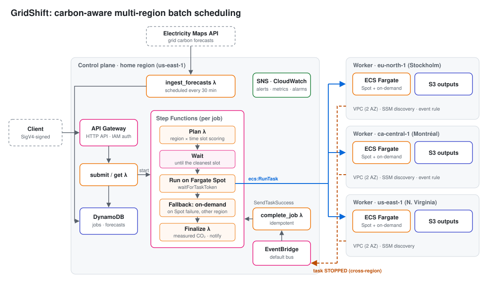

# GridShift: Architecture

## Problem

Batch workloads (encoding, reports, ETL, simulations, model training) usually don't care
*where* or *exactly when* they run, only that they finish before a deadline. The carbon
intensity of electricity differs by up to 25x between AWS regions and changes hour to hour
inside a region. Schedulers ignore this signal today.

GridShift is a multi-region workload orchestrator on AWS. It places each batch job in the
region and time slot with the lowest expected emissions, while respecting:

- **Deadline:** the job, plus a safety margin for Spot interruptions, must finish in time.
- **Cost budget:** the job may cost at most `max_cost_overhead_pct` more than running it now in its home region.
- **Data residency:** `allowed_regions` keeps regulated data inside approved regions.
- **Data gravity:** moving input data across regions costs money and energy, and both count against a region.

## High-level design



```
                         ┌───────────────────────── Control plane (home region) ─────────────────────────┐
  client ──SigV4──► API Gateway (HTTP, IAM auth)                                                         │
                         │  POST /jobs  ─► submit_job λ ─► DynamoDB jobs ─► Step Functions (per job)      │
                         │  GET  /jobs/{id} ─► get_job λ                       │                         │
                         │                                                     ▼                         │
                         │   EventBridge (30 min) ─► ingest_forecasts λ ─► DynamoDB forecasts            │
                         │                                     ▲                │                        │
                         │                       Electricity Maps API      plan_job λ (decision engine)  │
                         │                                                      │                        │
                         │                                       Wait until chosen start time            │
                         │                                                      │                        │
                         │                       dispatch_job λ (waitForTaskToken) ──RunTask──┐          │
                         │   complete_job λ ◄── EventBridge (ECS task STOPPED) ◄────────┐     │          │
                         │        └─ SendTaskSuccess/Failure                            │     │          │
                         │   finalize_job λ ─► SNS alerts, CloudWatch metrics + dashboard               │
                         └──────────────────────────────────────────────────────────────┼─────┼──────────┘
                                                                                        │     ▼
     ┌──────────── Worker region (×N, e.g. eu-north-1, ca-central-1, us-east-1) ────────┴──────────────┐
     │ VPC (2 AZ) ─ ECS cluster (Fargate Spot + Fargate) ─ task definition `gridshift-runner`           │
     │ S3 output bucket ─ CloudWatch Logs ─ SSM parameter /gridshift/worker/network                     │
     │ EventBridge rule: ECS "Task State Change" STOPPED ──cross-region──► home default event bus       │
     └──────────────────────────────────────────────────────────────────────────────────────────────────┘
```

## Job lifecycle (Step Functions)

1. **Plan:** `plan_job` loads forecasts for every allowed region, scores every
   (region, start-time) candidate, and stores the decision with its reasoning.
2. **Wait:** a `Wait` state sleeps until the chosen start time. A waiting job costs nothing.
3. **Dispatch:** `dispatch_job` calls `ecs:RunTask` in the target region on **Fargate Spot**
   and parks the execution on a task token.
4. **Complete:** when the ECS task stops, the worker region's EventBridge forwards the
   event to the home region. `complete_job` matches it to the job and resumes the workflow.
   A conditional DynamoDB update makes duplicate or late events harmless.
5. **Fallback:** if Spot capacity is interrupted or the task fails, the job is re-dispatched
   once to the fallback region on **on-demand Fargate**.
6. **Finalize:** the job record is updated with its actual runtime and emissions, metrics
   are emitted (CO₂ emitted and saved), and an SNS notification is sent.

## Carbon model

The coefficients follow the [Cloud Carbon Footprint](https://www.cloudcarbonfootprint.org/docs/methodology)
methodology:

| Quantity | Value |
|---|---|
| vCPU power | 0.74 W (idle) to 3.5 W (max), interpolated at 50% utilisation |
| Memory | 0.000392 kWh per GB-hour |
| Network transfer | 0.001 kWh per GB |
| PUE (AWS) | 1.135 |

`emissions (g) = energy (kWh) × grid intensity (gCO₂e/kWh)`

The grid intensity for a time window is the time-weighted average of the forecast points
that cover it. Any part of the window without forecast data is filled with the region's
static annual average, and the decision records how much forecast data it had.

## Key design decisions and trade-offs

| Decision | Why | Trade-off |
|---|---|---|
| Step Functions Standard + task token | Long waits are free, every step is auditable, and retries and catches are declarative | More moving parts than a cron job |
| Cross-region EventBridge for completion | Nothing polls. Worker regions stay decoupled from the control plane. | Events can arrive late or twice, so completion is idempotent |
| SSM parameter for worker discovery | Workers can be added or removed without redeploying the control plane | Lookup at runtime (cached per Lambda container) |
| Fargate Spot first, on-demand fallback | About 70% cheaper. Batch work tolerates interruption. | Needs a safety margin on the deadline (20%) |
| Two network modes | `public` has no inbound rules and no NAT, so it costs nothing extra. `private` has no internet route at all: VPC endpoints plus an ECR pull-through cache. | `private` costs about $0.01/hour per endpoint per AZ, so it's opt-in |
| Prices from the AWS Price List | Real per-region Fargate and per-route transfer prices, refreshed by a script | Spot isn't published, so it's modelled as a 70% discount |
| OIDC deploy role | GitHub Actions gets 1-hour credentials, limited to the repo's `production` environment. No stored keys. | The role can assume the CDK bootstrap roles, which are powerful by design |
| Pluggable carbon provider + static fallback | The system keeps working when the carbon API is down | The fallback is less precise |
| Job spec stored as JSON | Avoids DynamoDB Decimal conversions and keeps one schema | Spec fields can't be queried individually (not needed) |

## Security

- The API uses IAM (SigV4) auth, so there are no anonymous endpoints.
- Every Lambda has its own least-privilege role. `ecs:RunTask` is limited to the
  `gridshift-runner` family and the `gridshift-workers` cluster, and `iam:PassRole` only
  passes roles to `ecs-tasks.amazonaws.com`.
- S3 buckets block public access, enforce TLS and use server-side encryption.
- Task security groups allow no inbound traffic.
- The Electricity Maps API key is an SSM SecureString. It is never stored in code or the environment.

## Cost guardrails

- Serverless and pay-per-use everywhere. Idle cost is close to $0.
- An AWS Budget alarm (optional, set with `alert_email`).
- S3 lifecycle rule expires job outputs after 30 days, and logs are kept for 14 days.
- `make destroy` tears down every stack.

## Roadmap

1. Cognito-authenticated web dashboard (carbon vs. cost vs. latency per job).
2. Custom job images built once and replicated to every worker region (ECR replication).
3. Measured CPU utilisation (Container Insights) instead of a fixed 50% in the energy model.
4. Multi-account mode: workers in separate accounts behind AWS Organizations.
